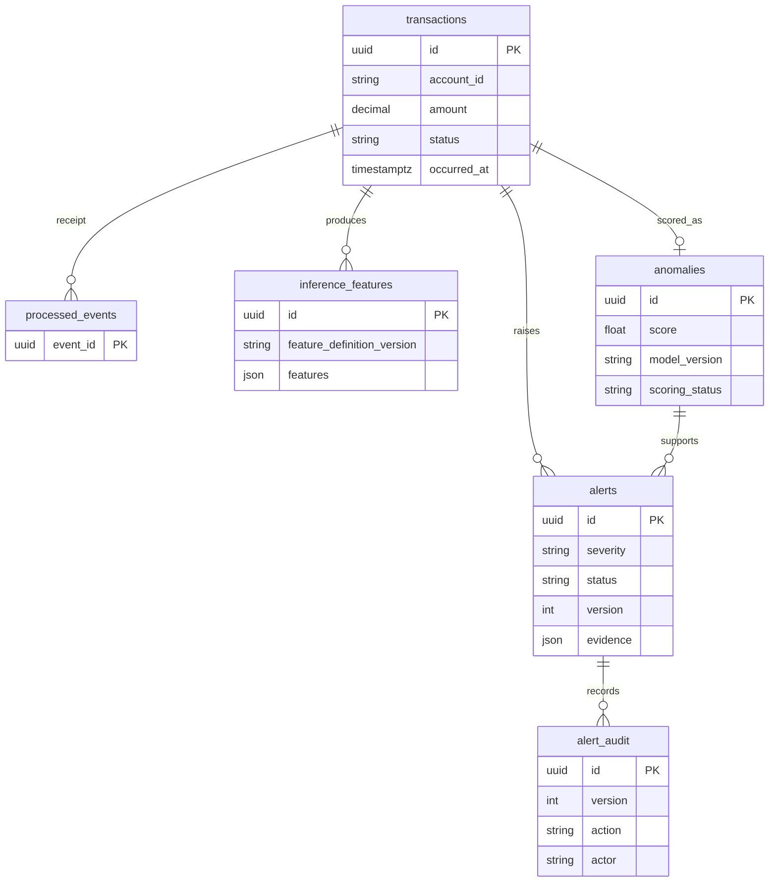

# Database model

The application supports PostgreSQL 17. SQLAlchemy 2 maps the tables, and Alembic revisions
`0001` through `0009` create and tune them. The running application never calls
`metadata.create_all()`; schema changes belong in migrations.



## Transactions

| Column | Type | Rules |
| --- | --- | --- |
| id | UUID | Primary key; generated by Python or PostgreSQL |
| account_id | varchar(128) | Required account identifier |
| merchant_id | varchar(128) | Optional merchant identifier |
| amount | numeric(18,2) | Required positive monetary amount |
| currency | varchar(3) | Required three uppercase ASCII letters; not an ISO registry lookup |
| country | varchar(2) | Required two uppercase letters |
| status | varchar(16) | pending, completed, failed, or refunded; defaults to pending |
| occurred_at | timestamptz | Required event time; callers should supply timezone-aware datetimes |
| device_id | varchar(128) | Optional device identifier used by features |
| ip_address | varchar(128) | Optional source identifier used by features; not assumed to be parsed IP data |
| payment_method | varchar(128) | Optional payment-method category |
| order_amount | numeric(18,2) | Optional positive order total |
| created_at | timestamptz | Database-generated insertion time |

Indexes support stable history/pagination `(occurred_at, id)`, account history
`(account_id, occurred_at)`, status/time `(status, occurred_at, id)`, country/time,
currency/time/ID, and creation-time reporting.
The primary key already indexes ID lookups. Numeric amounts are represented as
`Decimal` in Python, not floating point.

## Processed events

| Column | Type | Rules |
| --- | --- | --- |
| event_id | UUID | Producer-supplied primary key; globally unique across event types |
| transaction_id | UUID | Required foreign key to transactions; deletion is restricted |
| event_type | varchar(128) | Required event type/version string |
| processed_at | timestamptz | Database-generated processing time |

Indexes cover `transaction_id` audit lookups and `processed_at` retention scans.
Event IDs have no generated default: retries must reuse the original producer event ID.
The worker performs a fast receipt lookup to skip ordinary replay, while primary-key
enforcement remains authoritative and rejects duplicates, including concurrent inserts.

## Inference and alert tables

`inference_features` stores the immutable JSON feature vector, event ID, computation time, and feature-definition version; `(transaction_id, feature_definition_version)` is unique. `anomalies` stores one score per transaction with model version, scored/fallback status, safe failure reason, latency, and creation time.

`alerts` references both transaction and anomaly, preserves the source event ID, severity, policy/model versions, evidence JSON, workflow status, assignee, optimistic version, and timestamps. `(transaction_id, policy_version)` deduplicates policy output. `alert_audit` has a unique `(alert_id, version)` and stores action, authenticated actor, reason, before/after state, and timestamp. Alert deletion cascades audit history; transaction deletion cascades inference/anomaly/alert records but is not an operator API operation.

Current query indexes cover transaction list filters and stable ordering, alert queue status/time ordering, model/time reporting, transaction/event lookups, and audit traversal. Confirm index effectiveness with `scripts/explain_queries.py` on representative PostgreSQL data.

## Sessions and repositories

Repositories accept a SQLAlchemy `Session`. `add()` flushes to enforce database
constraints, but never commits. `get()` returns a row or `None`; the transaction
repository also provides bounded, ordered pagination with an optional account filter.

```python
from datetime import UTC, datetime
from decimal import Decimal
from uuid import uuid4

from app.db.repositories.processed_events import ProcessedEventRepository
from app.db.repositories.transactions import TransactionRepository
from app.db.session import get_session_factory
from app.models import ProcessedEvent, Transaction

event_id = uuid4()  # In a real consumer, read this from the producer's event.
with get_session_factory().begin() as session:
    transaction = TransactionRepository(session).add(Transaction(
        account_id="account-1", amount=Decimal("19.95"), currency="USD",
        occurred_at=datetime.now(UTC),
    ))
    ProcessedEventRepository(session).add(ProcessedEvent(
        event_id=event_id, transaction_id=transaction.id,
        event_type="transaction.created.v1",
    ))
```

The context commits on success, rolls back on an exception, and closes the session.
Keep the event marker and transaction write in this same unit of work. Duplicate IDs
raise `sqlalchemy.exc.IntegrityError` (PostgreSQL SQLSTATE `23505`) and roll back the
entire operation. Catch errors outside the transaction context so rollback completes.
Future FastAPI endpoints should use `Depends(get_session, scope="function")` to finish
the commit before sending a success response. Sessions are not shared across threads.

## Migration testing

`TEST_DATABASE_URL` explicitly enables integration tests. Each test creates a random
`test_monitoring_<uuid>` schema, changes its own connection's search path, and runs
real Alembic migrations there. Cleanup removes only that test schema. Tests never
downgrade the application's public schema. CI supplies its own PostgreSQL service.
