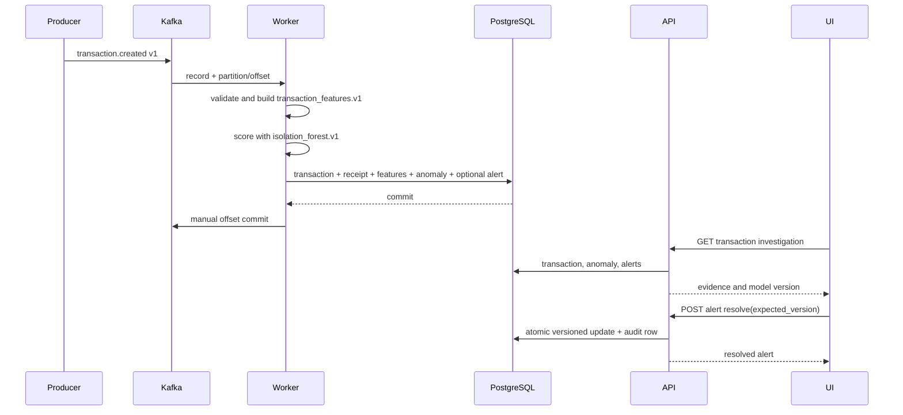

# Event-to-alert flow

The sequence below shows the normal path from a producer publishing an event to an operator
seeing the resulting transaction or alert.

Transient PostgreSQL failures are retried with capped full-jitter backoff and leave the Kafka offset uncommitted after exhaustion so supervision can restart and replay. Permanently malformed records are wrapped with topic, partition, offset, original bytes, attempts, and safe error metadata and published to `transactions.v1.dlq` before the source offset is committed. Replaying an already committed event returns `duplicate` and writes no second transaction, feature vector, anomaly, alert, or audit record.

The feature history query and final persistence occur in one database transaction. Events for the same account should be produced in business order; the end-to-end fixture explicitly waits for history persistence because Kafka ordering is only guaranteed within a partition.
