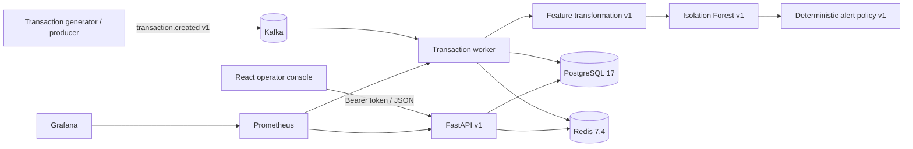

# Architecture overview

The system keeps operator requests separate from background transaction processing. Kafka
carries incoming events, PostgreSQL holds the durable record, and Redis stores counters and
caches that can expire. The API handles operator traffic but never scores a transaction; the
worker scores transactions but never serves operator requests.

## Trust and failure boundaries

- Only the worker consumes `transactions.v1`; it commits an offset after the database transaction succeeds or after a permanent failure is delivered to the DLQ.
- `processed_events.event_id` and database constraints provide idempotency during replay.
- Model artifacts are executable inputs baked into the worker image. Metadata, feature order, threshold configuration, and the model SHA-256 must agree before alerts are enabled.
- Business endpoints require an opaque bearer token. Redis-backed rate limiting fails closed; health and Prometheus endpoints remain suitable for private probes.
- The React application talks to the API through the Nginx `/api` same-origin proxy. It keeps credentials in memory only.
- Correlation IDs, event IDs, and transaction IDs join API and worker logs without logging payment-card data or authorization values.

## Deployment units

| Unit | Responsibility | Stateful |
| --- | --- | --- |
| `api` | REST, authentication, alert workflow, reporting | No |
| `worker` | consume, validate, feature, score, alert, persist | No |
| `web` | operator UI and API reverse proxy | No |
| `postgres` | transactions, inference, alerts, audit | Yes |
| `kafka` | ingestion and dead-letter topics | Yes |
| `redis` | rate limits, rolling metrics, response cache | Yes, recoverable |
| `prometheus` / `grafana` | telemetry collection and dashboards | Prometheus/Grafana volumes |

See [event flow](event-flow.md), [database model](data-model.md), and [deployment](../runbooks/deployment.md).
